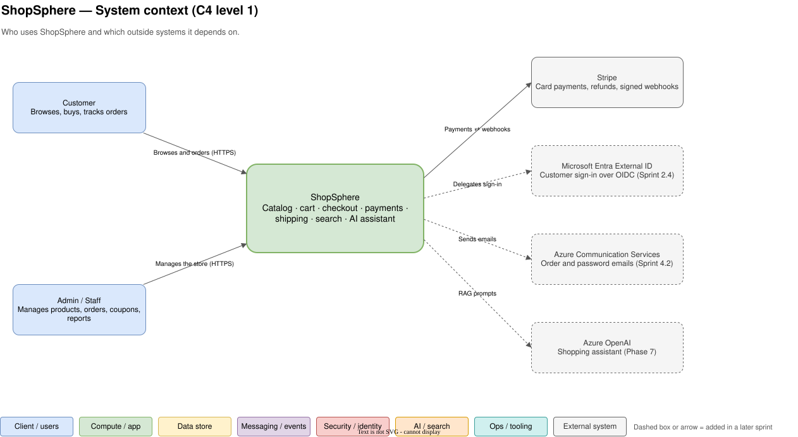
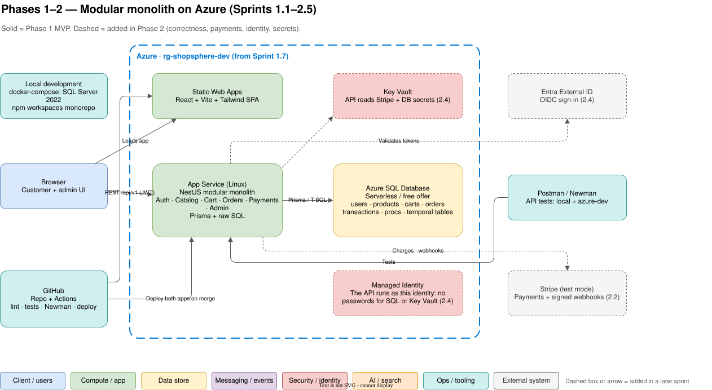
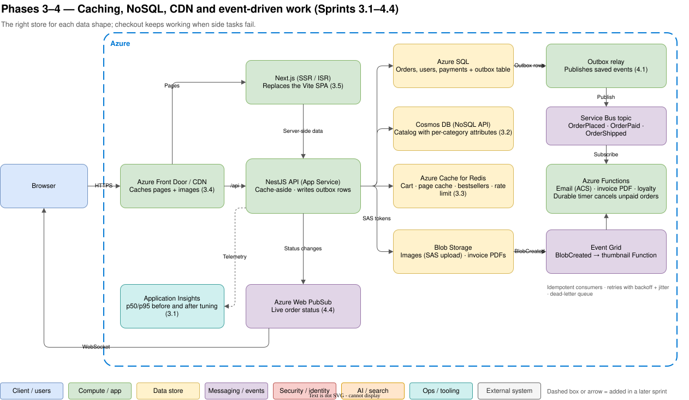
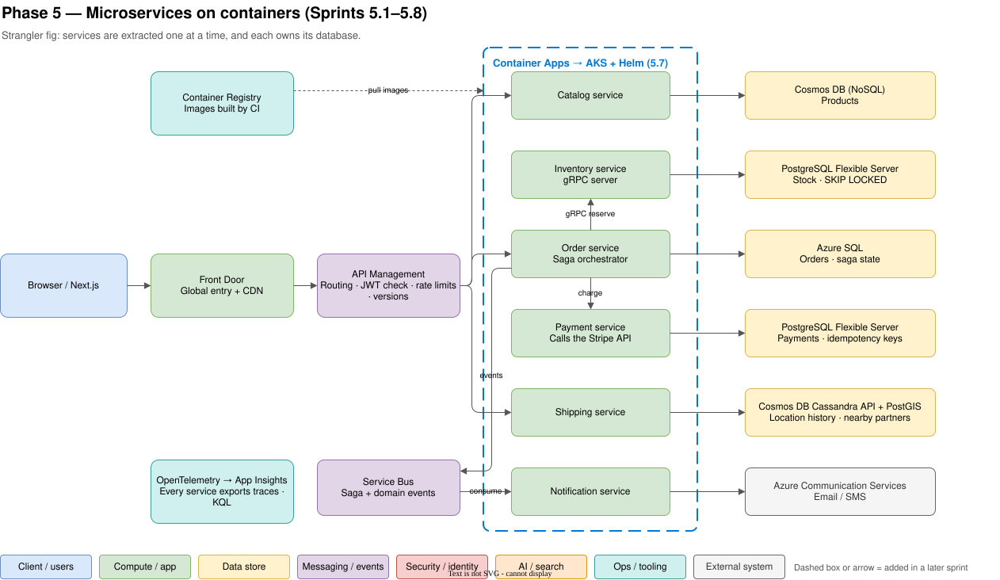
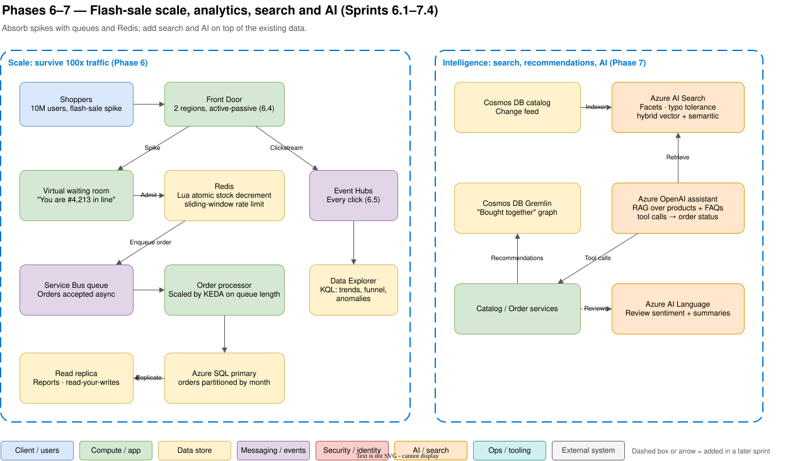
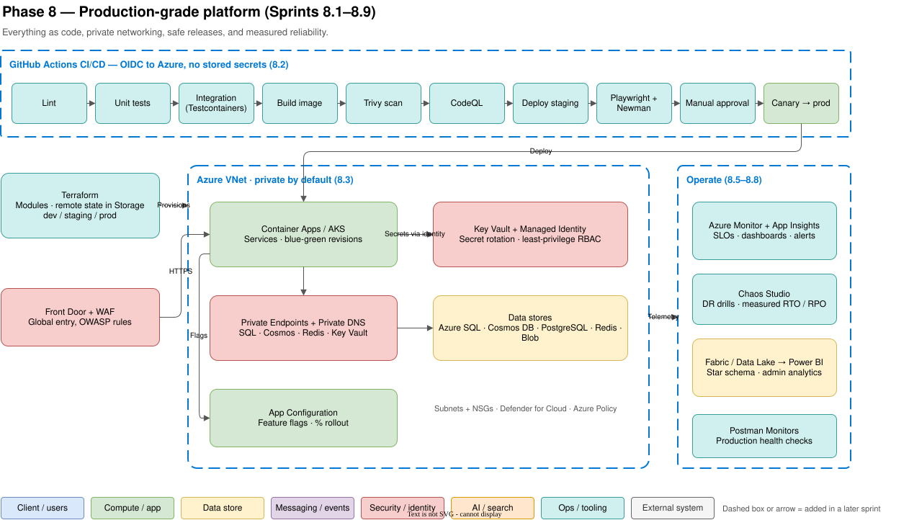

# ShopSphere Architecture

This document describes **what we are building, how the architecture grows phase by phase, and why each technology was chosen**. It is the map; [`ROADMAP.md`](ROADMAP.md) is the route, and the [ADRs](adr/) record each decision in detail.

- **Diagrams:** [`architecture/shopsphere.drawio`](architecture/shopsphere.drawio) (open in draw.io or the VS Code "Draw.io Integration" extension). The SVGs below are exported from it.
- **Status:** target architecture, written before development starts (2026-11-14). Sections are updated when a sprint changes reality.

---

## 1. Goals, non-goals and constraints

**Goals**

1. **Learn every layer of a modern full-stack system in depth** by building one realistic product, not many toy apps.
2. Grow the system the way real products grow: **monolith → correct → fast → reliable → distributed → scaled → intelligent → production-grade**. Each step is introduced only when the previous design visibly hurts, so the _reason_ for every pattern is felt, not just read.
3. End with a portfolio-quality system: working store on Azure, design notes, ADRs, diagrams, tests and CI/CD.

**Non-goals**

- Being the cheapest or simplest possible store. Some choices (microservices, several databases) are made **for learning** and are called out as such.
- Supporting real customers or real money. Stripe runs in test mode.

**Constraints**

| Constraint          | Effect on the design                                                                                                                                              |
| ------------------- | ----------------------------------------------------------------------------------------------------------------------------------------------------------------- |
| One developer       | One language (TypeScript) everywhere; a monorepo; heavy automation (hooks, CI) instead of reviewers.                                                              |
| ~15–20 h/week       | Sprints of about a week; managed Azure services over self-hosted ones.                                                                                            |
| Azure credit/budget | Azure starts only at Sprint 1.7; free tiers first (Azure SQL free offer, Cosmos DB free tier, Functions consumption); expensive resources deleted after practice. |
| Public repo         | No secrets in git, ever; noreply commit email; Key Vault + Managed Identity from Sprint 2.4.                                                                      |

## 2. Quality attributes (what we optimise for, in order)

1. **Correctness of money and stock.** Never oversell, never double-charge, never lose an order (Phase 2, then sagas in Phase 5).
2. **Availability of checkout.** Checkout keeps working when email, invoices or search are down (Phase 4: async, outbox, retries, DLQ).
3. **Performance.** p95 latency measured before and after every optimisation (Phase 3), and survival of a 100x flash-sale spike (Phase 6).
4. **Security.** Least privilege, no passwords between services, private networking, OWASP checks (Phases 2 and 8).
5. **Operability.** Every request traceable end to end; SLOs, alerts and runbooks (Phases 5 and 8).
6. **Cost.** Serverless and free tiers until load proves otherwise.

When two of these conflict, the higher one wins. Example: the transactional outbox (correctness) is chosen over "just publish the event after commit" (simpler, faster) because a lost `OrderPlaced` event is a correctness bug.

## 3. System context



| Actor / system               | Relationship                                                                |
| ---------------------------- | --------------------------------------------------------------------------- |
| Customer                     | Browses the catalog, manages a cart, checks out, tracks orders.             |
| Admin / staff                | Manages products, stock, orders, coupons; reads reports.                    |
| Stripe                       | Takes card payments; tells us the result through **signed webhooks**.       |
| Microsoft Entra External ID  | Customer sign-in over OIDC from Sprint 2.4 (before that: our own JWT auth). |
| Azure Communication Services | Sends order and password emails from Sprint 4.2.                            |
| Azure OpenAI                 | Powers the shopping assistant in Phase 7.                                   |

## 4. How the architecture evolves

| Phase | Theme            | Architecture shape                                                      | Diagram                                                       |
| ----- | ---------------- | ----------------------------------------------------------------------- | ------------------------------------------------------------- |
| 1     | Monolith MVP     | SPA + one NestJS API + one SQL database, on Azure                       | [Phases 1–2](architecture/02-phase1-2-monolith.svg)           |
| 2     | Correctness      | Same shape; transactions, locks, idempotency, Stripe, Key Vault, MI     | [Phases 1–2](architecture/02-phase1-2-monolith.svg)           |
| 3     | Performance      | Polyglot persistence (Cosmos, Redis, Blob), CDN, Next.js SSR            | [Phases 3–4](architecture/03-phase3-4-performance-async.svg)  |
| 4     | Reliability      | Event-driven side work: outbox → Service Bus → Functions                | [Phases 3–4](architecture/03-phase3-4-performance-async.svg)  |
| 5     | Microservices    | Six services, database per service, gRPC, saga, APIM, containers        | [Phase 5](architecture/04-phase5-microservices.svg)           |
| 6     | Scale            | Waiting room, Redis stock, queue-based ordering, replicas, multi-region | [Phases 6–7](architecture/05-phase6-7-scale-intelligence.svg) |
| 7     | Intelligence     | AI Search (hybrid vector), graph recommendations, RAG assistant         | [Phases 6–7](architecture/05-phase6-7-scale-intelligence.svg) |
| 8     | Production-grade | Terraform, full CI/CD, private networking, SLOs, DR, chaos              | [Phase 8](architecture/06-phase8-production.svg)              |

### 4.1 Phases 1–2: modular monolith



- **One deployable API** (NestJS on App Service) with **modules** per domain: Auth, Catalog, Cart, Orders, Payments, Admin. Modules talk through service interfaces, never through each other's tables. This is the seam we cut along in Phase 5.
- **One relational database** (Azure SQL). Orders, money and stock need ACID transactions, foreign keys and constraints. This is where SQL is strongest.
- **SPA on Static Web Apps.** Global static hosting, free tier, preview environments per PR.
- **Auth (Phase 1):** short-lived JWT access token in memory + refresh token rotated on every use, stored in an `HttpOnly; Secure; SameSite` cookie. **Phase 2.4** replaces our own login with Entra External ID and compares the two in a design note.
- **Phase 2 adds no new boxes for correctness.** It is about _behaviour_: row locks vs optimistic concurrency, a stored procedure for placing orders, idempotency keys, an order state machine, Stripe webhooks with signature checks.

### 4.2 Phases 3–4: performance and event-driven reliability



- **Measure first:** Application Insights p50/p95 before any optimisation; Query Store for slow SQL.
- **Polyglot persistence, each store for its data shape:**
  - _Catalog → Cosmos DB:_ products have different attributes per category (a phone has RAM, a shirt has size). Document storage fits; reads dominate; partitioned by `/categoryId` after comparing RU costs.
  - _Cart, hot pages, rate limits → Redis:_ in-memory speed, TTLs for abandoned carts, sorted sets for bestsellers.
  - _Images, invoices → Blob Storage:_ the browser uploads directly with a short-lived SAS token, so large files never pass through the API.
  - _Orders, users, payments stay in Azure SQL:_ they need transactions.
- **Front Door / CDN** caches images and pages at the edge. **Next.js** replaces the Vite SPA for server-side rendering (SEO for product pages) and ISR for the home page.
- **Event-driven side work (Phase 4):** placing an order writes the order **and** an `OrderPlaced` row into an **outbox table in the same transaction**. A relay publishes outbox rows to a **Service Bus topic**. **Functions** subscribe: email, invoice PDF, loyalty points. Consumers are idempotent, retry with exponential backoff + jitter, and poison messages go to the dead-letter queue. A **Durable Functions** timer cancels unpaid orders after 15 minutes. **Event Grid** reacts to blob uploads (thumbnails). **Web PubSub** pushes live order status to the browser.

### 4.3 Phase 5: microservices



| Service      | Owns                                | Database                          | Why that database                                                  |
| ------------ | ----------------------------------- | --------------------------------- | ------------------------------------------------------------------ |
| Catalog      | Products, categories                | Cosmos DB (NoSQL API)             | Flexible attributes, read-heavy, global distribution later         |
| Inventory    | Stock levels, reservations          | PostgreSQL Flexible Server        | `SELECT … FOR UPDATE SKIP LOCKED` for contention-free reservations |
| Order        | Orders, order items, saga state     | Azure SQL                         | Transactions, reporting SQL already written in Phases 1–2          |
| Payment      | Payments, refunds, idempotency keys | PostgreSQL Flexible Server        | Strong consistency; practise a second SQL dialect                  |
| Shipping     | Shipments, delivery locations       | Cosmos DB Cassandra API + PostGIS | Time-series location writes; geo queries ("partners within 5 km")  |
| Notification | Templates, delivery log             | (none / Table storage)            | Stateless consumer of events                                       |

- **Strangler fig:** extract Notification first (lowest risk), then Catalog, then the rest. The monolith keeps working the whole time.
- **Synchronous calls only where the caller needs an answer now** (Order → Inventory reservation over **gRPC**). Everything else is events over Service Bus.
- **Orchestrated checkout saga:** reserve stock → charge payment → confirm order; on failure run compensations (release stock, refund). Resilience: timeouts, retries, circuit breaker, bulkhead.
- **API Management** is the single public entry: routing, JWT validation, rate limits, versioning, developer portal.
- **Containers:** images in Azure Container Registry, run first on **Container Apps** (simple, serverless containers), then on **AKS with Helm** to learn Kubernetes properly.
- **OpenTelemetry** in every service; one order is traceable browser → Front Door → APIM → service → database.

### 4.4 Phases 6–7: scale and intelligence



- **Flash sale (10M users):** capacity estimate first; a **virtual waiting room** admits users at a safe rate; stock is decremented atomically in **Redis with a Lua script**; orders are accepted into a **queue** and processed asynchronously by a processor autoscaled with **KEDA** on queue length.
- **Database scale:** read replica for reports (with read-your-writes handling), `orders` table partitioned by month.
- **Multi-region:** Front Door with a passive second region; failover tested.
- **Clickstream analytics:** every click → **Event Hubs** → **Azure Data Explorer** for KQL (trends, funnels, anomaly detection).
- **Search:** **Azure AI Search** fed from the Cosmos DB change feed; facets, typo tolerance, then **hybrid keyword + vector search** with semantic ranking.
- **Recommendations:** "bought together" as a graph in **Cosmos DB Gremlin**.
- **Assistant:** **Azure OpenAI** with RAG over products, FAQs and the return policy (retrieved from AI Search) and tool calls for order status. **AI Language** for review sentiment and summaries.

### 4.5 Phase 8: production-grade



- **Terraform** for every resource: modules, remote state in Azure Storage, `dev` / `staging` / `prod`. Destroy and recreate an environment with one command.
- **CI/CD:** lint → unit → integration (Testcontainers) → image build → Trivy → CodeQL → deploy staging → Playwright + Newman → manual approval → canary to prod. GitHub authenticates to Azure with **OIDC federated credentials**, so no cloud secrets are stored in GitHub.
- **Network:** VNet, subnets, NSGs, **Private Endpoints** for SQL / Cosmos / Redis / Key Vault, Private DNS, **WAF** on Front Door.
- **Operations:** SLIs/SLOs and error budgets, dashboards and alerts, runbooks, a mock incident with a blameless postmortem, backups and point-in-time restore, DR drill with measured RTO/RPO, Chaos Studio.
- **Data platform:** Data Factory / Fabric → Data Lake → star schema → Power BI embedded in admin.

## 5. Key flows

### 5.1 Browse the catalog (Phase 3 shape)

1. Browser → Front Door. Static assets and images are served from the edge cache.
2. Product page → Next.js (SSR) → API `GET /api/v1/products/:id`.
3. API checks **Redis** (cache-aside). Hit → return. Miss → read **Cosmos DB** (point read by id + partition key) → store in Redis with a TTL → return.
4. A price change invalidates the Redis key (Sprint 3.3 "stale data" exercise).

### 5.2 Checkout (Phase 2 → Phase 4)

1. `POST /api/v1/orders` with an `Idempotency-Key` header. A repeated key returns the first response.
2. **One SQL transaction:** lock/decrement stock (`UPDATE … WHERE stock >= @qty`), insert order + items, clear cart, insert `OrderPlaced` into the **outbox**. Commit.
3. Create a Stripe payment; the order is `PENDING`.
4. Stripe calls our **webhook**. We verify the signature, look up the event id (dedupe), move the order to `PAID`, and write `OrderPaid` to the outbox in the same transaction.
5. The relay publishes outbox events; Functions send the email and generate the invoice. If email is down, messages wait in the queue; checkout is unaffected.
6. A Durable Functions timer cancels the order and releases stock if it is still unpaid after 15 minutes.

### 5.3 Checkout as a saga (Phase 5)

Order service (orchestrator): `ReserveStock` (Inventory, gRPC) → `Charge` (Payment) → `ConfirmOrder`. If `Charge` fails: `ReleaseStock` and mark the order `FAILED`. Every step is idempotent and its state is persisted, so a crashed orchestrator resumes where it stopped.

## 6. Cross-cutting concerns

| Concern       | Approach                                                                                                                                                                                                                              |
| ------------- | ------------------------------------------------------------------------------------------------------------------------------------------------------------------------------------------------------------------------------------- |
| Security      | Validation at every boundary (DTOs + `ValidationPipe`, Zod on the web), parameterised SQL only, bcrypt, rate limiting, CORS allow-list, Key Vault + Managed Identity, OWASP ZAP, CodeQL, Dependabot, STRIDE threat model of checkout. |
| Observability | Request IDs from Sprint 1.1 → App Insights (3.1) → OpenTelemetry distributed tracing (5.6) → SLOs and alerts (8.5).                                                                                                                   |
| Testing       | Pyramid: unit (Jest) → integration against a real DB in Docker → contract → API (Postman/Newman) → E2E (Playwright) → load (k6 / Azure Load Testing) → chaos.                                                                         |
| Configuration | `.env` locally (only `.env.example` committed) → App Settings → Key Vault references → App Configuration with feature flags.                                                                                                          |
| API design    | REST, versioned `/api/v1`, OpenAPI at `/docs`, consistent error format, cursor or offset pagination (decided in a design note), `Idempotency-Key` on writes that move money.                                                          |
| Environments  | `local` (docker-compose) → `azure-dev` (Phase 1) → `dev` / `staging` / `prod` via Terraform (Phase 8).                                                                                                                                |
| Cost          | Budget alert before the first resource; free tiers; tags; delete AKS / APIM / Data Explorer / Front Door Premium after practice; monthly cost report (8.8).                                                                           |

## 7. Technology choices and why

Each row links to an ADR with the full context, alternatives and trade-offs.

### 7.1 Languages, frameworks and tooling

| Technology                                 | What it is                              | Why we use it                                                                                                                                                                                                                           | Alternatives considered                            | From      |
| ------------------------------------------ | --------------------------------------- | --------------------------------------------------------------------------------------------------------------------------------------------------------------------------------------------------------------------------------------- | -------------------------------------------------- | --------- |
| **TypeScript** (strict, `~6.0`)            | Typed superset of JavaScript            | One language for browser, API, functions and scripts; types shared between frontend and backend catch contract bugs at compile time. Pinned to 6.0 because TS 7 has no compiler API yet ([ADR-0002](adr/0002-typescript-everywhere.md)) | Java/Spring, C#/.NET, Go, Python                   | 1.0       |
| **Node.js 24**                             | JavaScript runtime                      | Current LTS line, first-class on App Service, Functions and containers; pinned in `.nvmrc` + `engines`                                                                                                                                  | Deno, Bun                                          | 1.0       |
| **npm workspaces monorepo**                | Several packages in one repo            | One install, one CI, shared tsconfig/lint, a `shared` package for types, atomic changes across API + web ([ADR-0003](adr/0003-monorepo-npm-workspaces.md))                                                                              | Polyrepo, pnpm, Nx, Turborepo                      | 1.0       |
| **NestJS**                                 | Structured Node.js backend framework    | Modules, dependency injection, guards, pipes, interceptors: enterprise structure that maps directly to the modular monolith and later microservices ([ADR-0004](adr/0004-nestjs-backend.md))                                            | Express, Fastify, Hono                             | 1.1       |
| **React + Vite → Next.js**                 | UI library; build tool; React framework | Learn React fundamentals first without framework magic, then migrate to Next.js when SSR/SEO is actually needed ([ADR-0005](adr/0005-react-vite-then-nextjs.md))                                                                        | Angular, Vue, SvelteKit, Next.js from day one      | 1.4 / 3.5 |
| **Tailwind CSS**                           | Utility-first CSS                       | Fast, consistent, responsive styling without a component library hiding CSS                                                                                                                                                             | CSS Modules, MUI, Bootstrap                        | 1.4       |
| **TanStack Query**                         | Server-state cache for React            | Loading/error/empty states, caching, retries and invalidation for API data                                                                                                                                                              | Redux Toolkit Query, SWR, hand-written `useEffect` | 1.4       |
| **React Hook Form + Zod**                  | Forms + schema validation               | Performant forms; one Zod schema validates and types the data                                                                                                                                                                           | Formik, Yup                                        | 1.5       |
| **Prisma + raw SQL**                       | ORM + hand-written SQL                  | Prisma for migrations and everyday CRUD with type safety; raw SQL for joins, window functions, locks and procedures, because the goal is to learn SQL deeply ([ADR-0006](adr/0006-prisma-plus-raw-sql.md))                              | TypeORM, Drizzle, Knex, raw SQL only               | 1.2       |
| **Jest, Testcontainers, Playwright, k6**   | Unit, integration, E2E, load testing    | The standard tool at each level of the test pyramid                                                                                                                                                                                     | Vitest, Cypress, JMeter                            | 1.6 → 8.8 |
| **Postman + Newman**                       | API client + CLI runner                 | Collections double as living API docs; Newman runs them in CI; mocks, monitors and OAuth helpers later ([ADR-0015](adr/0015-postman-newman-api-testing.md))                                                                             | Insomnia, Bruno, REST Client, supertest only       | 1.1       |
| **ESLint + Prettier + Husky + commitlint** | Linting, formatting, git hooks          | Consistent code and conventional commits enforced locally and in CI                                                                                                                                                                     | Biome, Rome                                        | 1.0       |

### 7.2 Data

| Technology                                            | Why                                                                                                                                                                                                                                               | Alternatives                                            | From      |
| ----------------------------------------------------- | ------------------------------------------------------------------------------------------------------------------------------------------------------------------------------------------------------------------------------------------------- | ------------------------------------------------------- | --------- |
| **Azure SQL Database** (SQL Server in Docker locally) | Orders and money need ACID transactions, constraints and locking; T-SQL teaches procedures, temporal tables, window functions, Query Store; serverless/free offer keeps cost near zero ([ADR-0007](adr/0007-azure-sql-for-transactional-data.md)) | PostgreSQL only, MySQL                                  | 1.2       |
| **Cosmos DB (NoSQL API)**                             | Catalog has per-category attributes and is read-heavy; learn partition keys, RUs, change feed; free tier ([ADR-0008](adr/0008-cosmos-db-for-catalog.md))                                                                                          | MongoDB Atlas, keeping catalog in SQL with JSON columns | 3.2       |
| **Azure Cache for Redis**                             | Sub-millisecond reads, TTLs, sorted sets, atomic Lua scripts for flash-sale stock ([ADR-0009](adr/0009-redis-cache-and-cart.md))                                                                                                                  | In-process cache, Memcached                             | 3.3       |
| **Blob Storage + Front Door/CDN**                     | Cheap object storage, direct browser uploads with SAS, edge caching                                                                                                                                                                               | Storing images in the DB, third-party CDN               | 3.4       |
| **PostgreSQL Flexible Server**                        | Second SQL dialect, `SKIP LOCKED`, `JSONB`, PostGIS for geo queries                                                                                                                                                                               | Azure SQL for everything                                | 5.3       |
| **Cosmos DB Cassandra / Gremlin APIs**                | Experience wide-column (query-first) and graph modelling on one managed service                                                                                                                                                                   | Managed Cassandra, Neo4j                                | 5.5 / 7.3 |
| **Event Hubs + Data Explorer**                        | High-throughput event ingestion and fast KQL analytics on clickstream                                                                                                                                                                             | Kafka, Elasticsearch                                    | 6.5       |
| **Azure AI Search**                                   | Managed full-text, facets, vector + semantic hybrid search                                                                                                                                                                                        | Elasticsearch/OpenSearch, pgvector                      | 7.1       |

### 7.3 Messaging and integration

| Technology                                             | Why                                                                                                                                                                                                          | Alternatives                                          | From |
| ------------------------------------------------------ | ------------------------------------------------------------------------------------------------------------------------------------------------------------------------------------------------------------ | ----------------------------------------------------- | ---- |
| **Service Bus (topics/queues) + transactional outbox** | Enterprise messaging with sessions, dead-lettering, duplicate detection; the outbox guarantees no event is lost between DB commit and publish ([ADR-0010](adr/0010-service-bus-and-transactional-outbox.md)) | Storage Queues, RabbitMQ, Kafka, publish-after-commit | 4.1  |
| **Azure Functions (+ Durable)**                        | Event-driven consumers that scale to zero; Durable timers for "cancel unpaid order"                                                                                                                          | Background workers in the API, Hangfire, cron         | 4.2  |
| **Event Grid**                                         | Reactive events from Azure resources (blob created)                                                                                                                                                          | Polling                                               | 4.3  |
| **Web PubSub**                                         | Managed WebSockets for live order status                                                                                                                                                                     | Self-hosted Socket.IO, polling                        | 4.4  |
| **gRPC**                                               | Typed, fast service-to-service calls where the caller needs an immediate answer                                                                                                                              | REST between services                                 | 5.3  |
| **API Management**                                     | One gateway: routing, JWT validation, rate limits, versioning, developer portal                                                                                                                              | Self-hosted gateway (YARP, Kong), Front Door only     | 5.6  |

### 7.4 Compute and hosting

| Technology                               | Why                                                                                                                                                          | Alternatives                     | From      |
| ---------------------------------------- | ------------------------------------------------------------------------------------------------------------------------------------------------------------ | -------------------------------- | --------- |
| **App Service (Linux)**                  | Simplest managed host for one API; slots, App Settings, Managed Identity                                                                                     | VM, containers from day one      | 1.7       |
| **Static Web Apps**                      | Free global hosting for the SPA with PR preview environments                                                                                                 | Blob static website + CDN        | 1.7       |
| **Modular monolith first**               | Fast to build and change while domains are still unclear; module boundaries become service boundaries later ([ADR-0011](adr/0011-modular-monolith-first.md)) | Microservices from day one       | 1.1       |
| **Docker → Container Apps → AKS + Helm** | Learn containers on a simple platform first, then Kubernetes for full control (HPA, probes, ingress) ([ADR-0012](adr/0012-container-apps-then-aks.md))       | AKS only, App Service containers | 5.1 / 5.7 |

### 7.5 Identity, security, delivery and operations

| Technology                                               | Why                                                                                                                                  | Alternatives                                | From      |
| -------------------------------------------------------- | ------------------------------------------------------------------------------------------------------------------------------------ | ------------------------------------------- | --------- |
| **Own JWT auth → Entra External ID**                     | Build auth once to understand tokens and cookies, then delegate to a real identity provider and compare                              | Auth0, Cognito, Keycloak                    | 1.3 / 2.4 |
| **Key Vault + Managed Identity**                         | No secrets in code or config; passwordless access between Azure services                                                             | Env vars, connection strings with passwords | 2.4       |
| **GitHub Actions + OIDC**                                | CI next to the code; free for public repos; OIDC removes stored cloud credentials ([ADR-0014](adr/0014-github-actions-with-oidc.md)) | Azure DevOps Pipelines, Jenkins             | 1.0 / 8.2 |
| **Terraform**                                            | Most widely used IaC across clouds; teaches state, plans, modules and drift ([ADR-0013](adr/0013-terraform-for-iac.md))              | Bicep, Pulumi, portal clicks                | 8.1       |
| **Application Insights + OpenTelemetry + Azure Monitor** | Vendor-neutral instrumentation, Azure-native storage and KQL                                                                         | Prometheus + Grafana, Datadog               | 3.1 / 5.6 |
| **Stripe (test mode)**                                   | Industry-standard payments API with real webhook and idempotency semantics                                                           | Razorpay, PayPal                            | 2.2       |

## 8. Repository layout (target)

```
shopsphere/
├── apps/
│   ├── api/            NestJS API (modular monolith; later split into services/)
│   └── web/            React + Vite SPA (Next.js from Sprint 3.5)
├── packages/
│   └── shared/         Types and Zod schemas shared by api and web
├── services/           Extracted microservices (Phase 5)
├── functions/          Azure Functions (Phase 4)
├── infra/              Terraform (Phase 8)
├── postman/            Collections and environments
├── docs/
│   ├── ARCHITECTURE.md this document
│   ├── ROADMAP.md      sprints and self-checks
│   ├── adr/            architecture decision records
│   ├── architecture/   draw.io source + exported SVGs
│   ├── design-notes/   break-and-fix write-ups
│   └── sessions/       session logs
└── docker-compose.yml  local infrastructure
```

## 9. Proof of concept: the walking skeleton

Before building features, a **walking skeleton** proves every layer connects: the thinnest slice that runs end to end and deploys through CI.

| Layer    | Skeleton                                                                                       |
| -------- | ---------------------------------------------------------------------------------------------- |
| Database | SQL Server 2022 in `docker-compose`, one `Product` table via a Prisma migration, 5 seeded rows |
| API      | NestJS: `GET /health`, `GET /api/v1/products`                                                  |
| Shared   | `packages/shared` exports the `Product` type used by both apps                                 |
| Web      | Vite + React page that fetches and lists the products                                          |
| CI       | Root `typecheck` script; CI builds and type-checks both apps                                   |

The skeleton is **not thrown away**. Sprints 1.1–1.4 grow it into the real MVP.

## 10. Decision records

| ADR                                                      | Decision                                          |
| -------------------------------------------------------- | ------------------------------------------------- |
| [0001](adr/0001-record-architecture-decisions.md)        | Record architecture decisions as ADRs             |
| [0002](adr/0002-typescript-everywhere.md)                | TypeScript everywhere                             |
| [0003](adr/0003-monorepo-npm-workspaces.md)              | Monorepo with npm workspaces                      |
| [0004](adr/0004-nestjs-backend.md)                       | NestJS for the backend                            |
| [0005](adr/0005-react-vite-then-nextjs.md)               | React + Vite first, Next.js in Phase 3            |
| [0006](adr/0006-prisma-plus-raw-sql.md)                  | Prisma for CRUD and migrations, raw SQL for depth |
| [0007](adr/0007-azure-sql-for-transactional-data.md)     | Azure SQL for transactional data                  |
| [0008](adr/0008-cosmos-db-for-catalog.md)                | Cosmos DB for the catalog                         |
| [0009](adr/0009-redis-cache-and-cart.md)                 | Redis for cache, cart and counters                |
| [0010](adr/0010-service-bus-and-transactional-outbox.md) | Service Bus with a transactional outbox           |
| [0011](adr/0011-modular-monolith-first.md)               | Modular monolith first                            |
| [0012](adr/0012-container-apps-then-aks.md)              | Container Apps first, then AKS                    |
| [0013](adr/0013-terraform-for-iac.md)                    | Terraform for infrastructure as code              |
| [0014](adr/0014-github-actions-with-oidc.md)             | GitHub Actions with OIDC                          |
| [0015](adr/0015-postman-newman-api-testing.md)           | Postman and Newman for API testing                |

## 11. Updating the diagrams

1. Open `docs/architecture/shopsphere.drawio` in draw.io Desktop or the VS Code Draw.io Integration extension and edit the page.
2. Re-export the changed page as SVG (light theme), keeping the file names, for example:

   ```bash
   "C:/Program Files/draw.io/draw.io.exe" -x -p 2 --theme light --embed-svg-fonts false \
     -o docs/architecture/02-phase1-2-monolith.svg docs/architecture/shopsphere.drawio
   ```

3. Commit the `.drawio` and the SVG together so they never drift apart.
